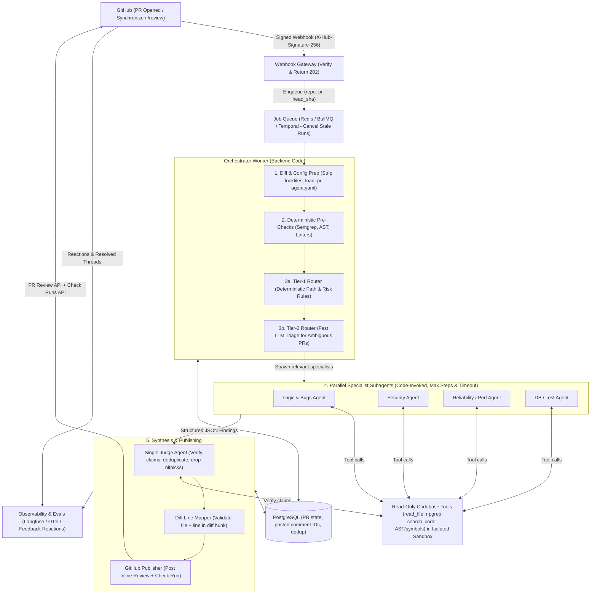

# System Architecture & High-Level Design (HLD)

## Core Pattern: Orchestrator–Workers (Map–Reduce)

Rather than using a single monolithic LLM loop or an unconstrained multi-agent chat swarm, the system uses a **code-controlled Orchestrator** that dispatches **isolated, parallel specialist subagents** and routes their outputs to a **single Judge**:

1. **Your Backend Code Owns Control Flow:** Webhooks, queueing, stale-job cancellation, subagent dispatch, timeouts, and GitHub API writes are all deterministic code.
2. **Subagents Are Isolated & Read-Only:** Specialists never communicate with each other and never write to GitHub. They investigate the codebase using bounded read-only tools and return structured JSON findings.
3. **Single Quality Gate:** Every candidate finding is verified and deduplicated by a single Judge before being mapped to GitHub diff hunks and published.

---

## High-Level Design Diagram

---

## Component Responsibilities

### 1. Webhook Gateway
- Validates `X-Hub-Signature-256` on every incoming GitHub webhook.
- Filters out irrelevant events (e.g., draft PRs if disabled by repo config).
- Returns `202 Accepted` immediately (within GitHub's ~10s timeout) and enqueues a job keyed by `(repo_id, pr_number, head_sha)`.

### 2. Job Queue & Concurrency Control
- Handles retries with backoff and deduplicates repeated webhook deliveries.
- Supersedes or cancels in-flight review jobs when a newer commit (`synchronize`) arrives for the same PR.

### 3. Orchestrator Worker
- **Diff & Config Prep:** Clones/fetches the PR branch into an isolated workspace, strips noisy generated files (`package-lock.json`, `dist/`, `*.min.js`), and loads `.pr-agent.yaml` / `AGENTS.md`.
- **Deterministic Pre-Checks:** Runs fast static analyzers (e.g., Semgrep, linters, typecheckers) so LLMs don't waste tokens rediscovering deterministic issues.
- **Two-Tier Router:**
  - *Tier 1 (Deterministic Rules):* Maps file paths and metadata to specialists (e.g., `*.sql` / `migrations/` → DB Agent; `auth/` / routes → Security Agent; docs-only → skip).
  - *Tier 2 (Lightweight LLM Triage):* For ambiguous changes, a fast/cheap model inspects the PR title, description, and changed symbols and outputs a JSON list of specialists to invoke.

### 4. Parallel Specialist Subagents
- Invoked concurrently by orchestrator code (`asyncio.gather` / `Promise.all`) with strict step caps (e.g., 8–10 tool turns) and timeouts (e.g., 45s).
- Equipped with strictly **read-only** codebase tools (`read_file`, `search_code`, `get_symbol_definition`).
- Output strict schema-validated JSON findings: `{ file, line, side, severity, confidence, title, explanation, suggested_fix }`.

### 5. Single Judge & Publisher
- **Judge:** Reviews all candidate findings, verifies claims against the actual code if needed, merges/deduplicates overlapping findings, drops low-confidence style nitpicks, and checks against previously dismissed threads.
- **Diff Line Mapper:** Ensures every inline comment maps to a valid `(file, line, side)` inside a GitHub diff hunk (preventing `422 Unprocessable Entity` errors), falling back to the summary body when needed.
- **GitHub Publisher:** Submits a single clean Pull Request Review and updates the associated GitHub Check Run.

