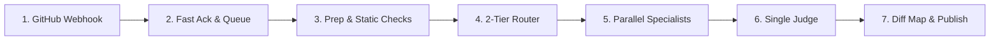

# End-to-End Pipeline Flow

## Overview

---

## Step-by-Step Walkthrough

1. **Trigger & Fast Ack:** A developer opens a PR, pushes a new commit (`synchronize`), or comments `/review`. The Webhook Gateway verifies `X-Hub-Signature-256`, enqueues `(repo_id, pr_number, head_sha)`, and returns `202 Accepted`.
2. **Queue Deduplication:** If an older commit on the same PR is still being reviewed, it is cancelled or marked stale so outdated comments are never posted.
3. **Workspace & Diff Prep:** The worker fetches the PR diff, metadata (title, description, linked issues), repo rules (`.pr-agent.yaml` / `AGENTS.md`), and strips generated/lockfiles.
4. **Deterministic Pre-Checks:** Static tools (Semgrep, AST checks, linters) scan changed files and attach their results to the shared run context.
5. **Two-Tier Routing:**
   - Tier 1 deterministic rules handle obvious skips (docs/lockfiles only) and path triggers.
   - Tier 2 lightweight LLM triage selects any additional specialists needed for ambiguous files.
6. **Parallel Specialist Execution:** Your orchestrator code launches the selected specialists in parallel. Each specialist uses read-only tools (`read_file`, `search_code`) to check callers, schemas, auth middleware, and tests, returning structured JSON candidates.
7. **Judge & Verification:** The single Judge validates each candidate finding against the code and existing PR comment history, removes duplicates and nitpicks, and approves only high-signal findings.
8. **Diff Mapping & Publish:** The Diff Line Mapper verifies `(file, line)` positions against the PR diff hunks, and the publisher posts one cohesive Pull Request Review + Check Run status.

---

## Concrete Example: `PR #412 — Add order refund endpoint`

Suppose a PR modifies:
- `routes/orders.ts` (adds `POST /orders/:id/refund`)
- `services/refund.ts` (updates DB + calls Stripe refund API)
- `README.md` (updates API docs)

1. **Prep & Routing:** `README.md` is ignored for deep review. `routes/orders.ts` and `services/refund.ts` touch API routes, DB writes, and payments, so the Router selects **3 specialists in parallel**: `Logic`, `Security`, and `Reliability`.
2. **Parallel Specialists:**
   - **Logic Agent** checks `Order` schema via `search_code` and finds:
     - *Candidate 1:* Double-refund bug—no check if `order.status === "refunded"`.
     - *Candidate 2 (nitpick):* Rename `amt` to `amount`.
   - **Security Agent** reads `middleware/auth.ts` and finds:
     - *Candidate 3:* IDOR vulnerability—`requireAuth` checks login, not `order.userId === req.user.id`.
   - **Reliability Agent** inspects `services/refund.ts` and `lib/stripe.ts`:
     - *Candidate 4:* Stripe API call is inside the DB transaction (holds DB lock + risk of partial failure).
     - *Candidate 5 (false positive):* Suggests adding Stripe retries (already configured in `lib/stripe.ts`).
3. **Single Judge:**
   - Keeps **Candidates 1, 3, and 4** (real bugs).
   - Drops **Candidate 2** (style nitpick) and **Candidate 5** (verified false positive).
4. **Publish:** Posts 1 concise summary + 3 inline comments on exact diff lines and marks the Check Run accordingly.

